<p align="center">
  
</p>

<h1 align="center">BG Bites</h1>
<p align="center"><em>Discover the taste of Bulgaria</em></p>

<p align="center">
  An iOS app for finding traditional Bulgarian recipes, cooking them step by step and saving favourites.<br>
  Built with SwiftUI in Xcode.
</p>

<p align="center">
  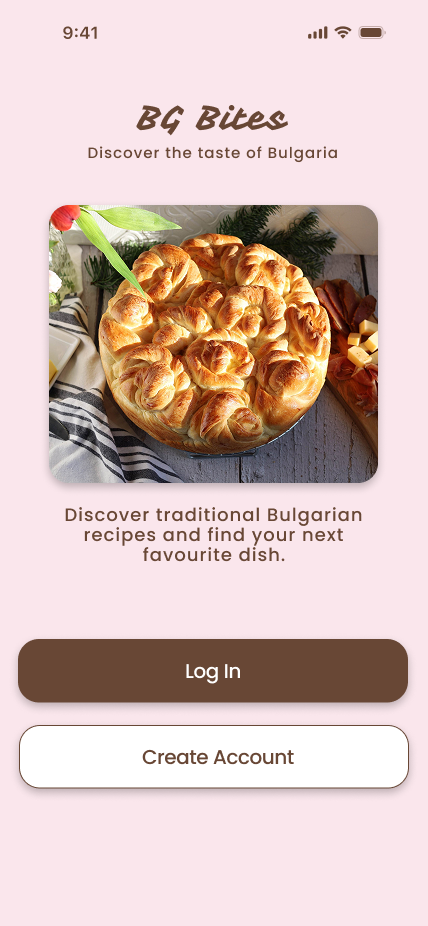
  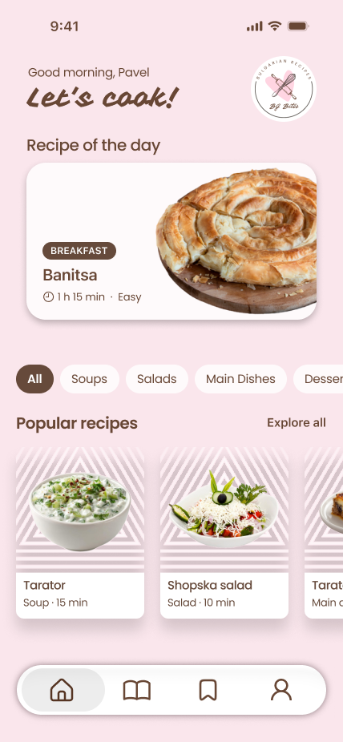
  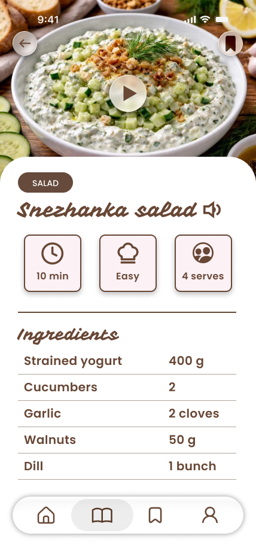
  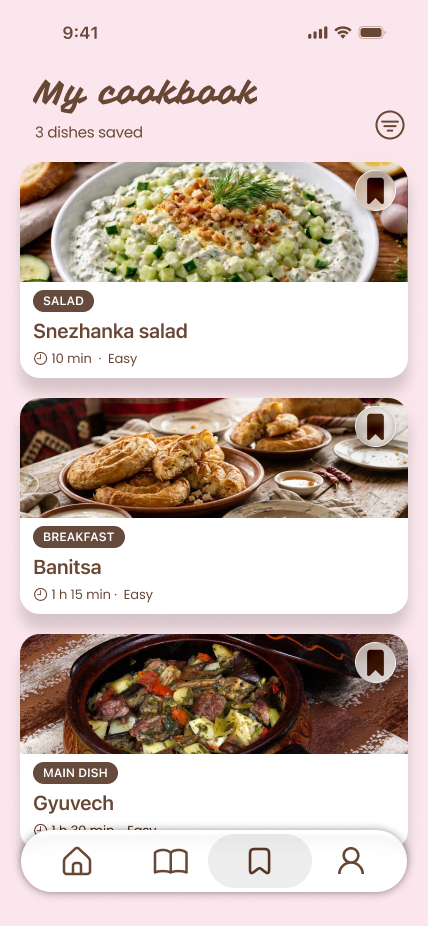
</p>

---

## Entry screens

<table align="center">
  <tr>
    <td align="center"><br><sub><b>1. Welcome</b></sub></td>
    <td align="center">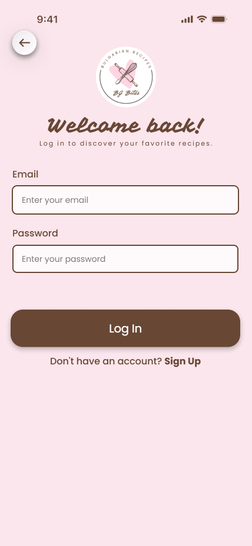<br><sub><b>2. Log In</b></sub></td>
    <td align="center">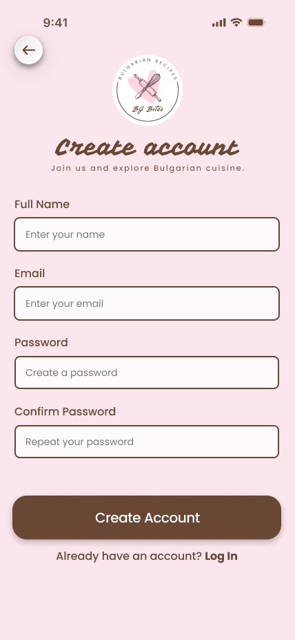<br><sub><b>3. Register</b></sub></td>
  </tr>
</table>

## Home

<table align="center">
  <tr>
    <td align="center"><br><sub><b>4. Home</b></sub></td>
    <td align="center">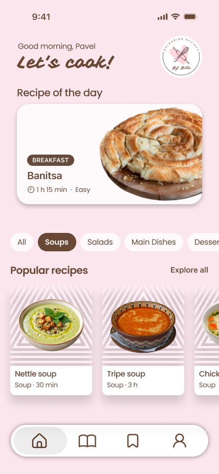<br><sub><b>5. Home – Soups</b></sub></td>
  </tr>
</table>

## Recipes

<table align="center">
  <tr>
    <td align="center">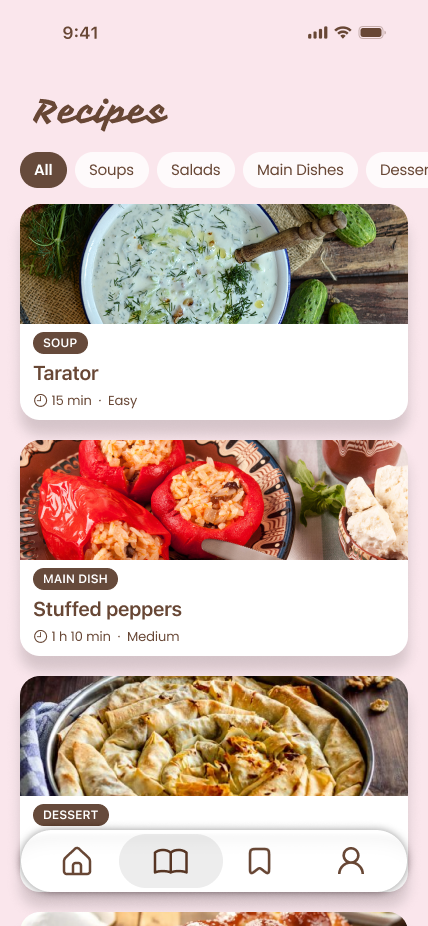<br><sub><b>6. Recipes</b></sub></td>
    <td align="center">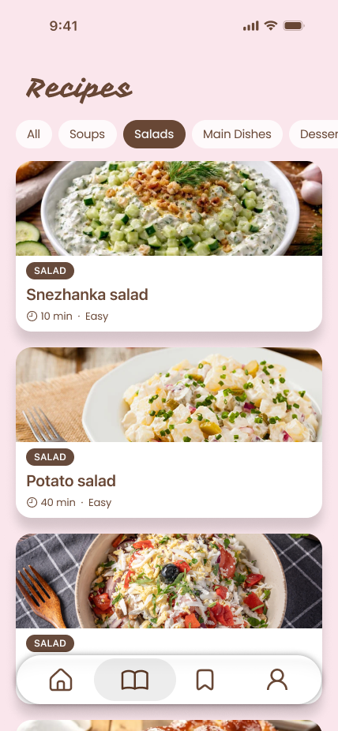<br><sub><b>7. Recipes – Salads</b></sub></td>
  </tr>
</table>

## Recipe page

<table align="center">
  <tr>
    <td align="center"><br><sub><b>8. Recipe – top</b></sub></td>
    <td align="center">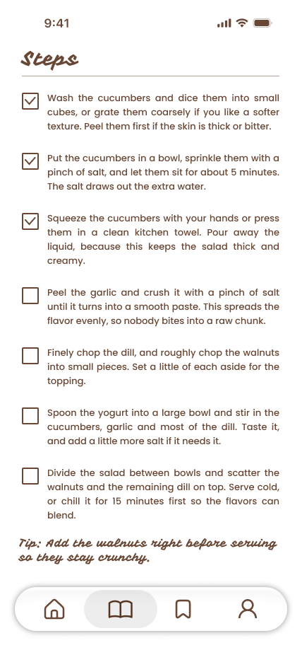<br><sub><b>9. Recipe – steps</b></sub></td>
  </tr>
</table>

## Cookbook and profile

<table align="center">
  <tr>
    <td align="center"><br><sub><b>10. My cookbook</b></sub></td>
    <td align="center">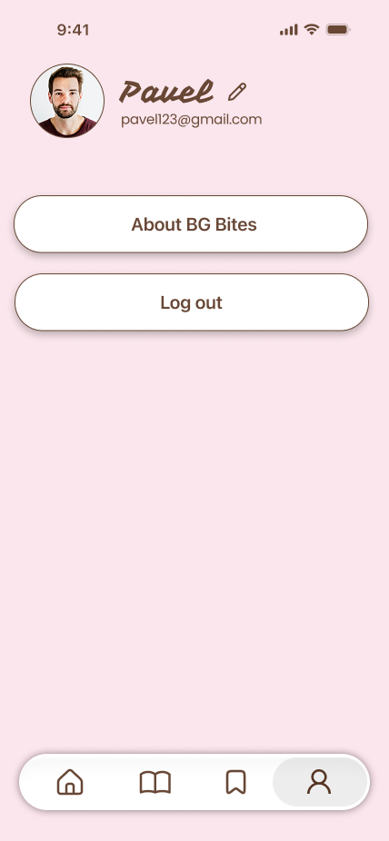<br><sub><b>11. Profile</b></sub></td>
    <td align="center">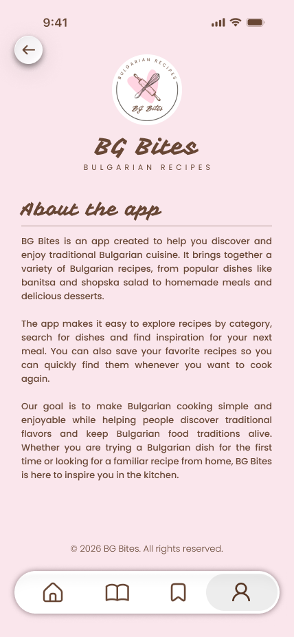<br><sub><b>12. About BG Bites</b></sub></td>
  </tr>
</table>

---

## Features

- Create an account and log in
- Browse recipes by category: All, Soups, Salads, Main Dishes, Desserts
- Recipe cards with photo, category tag, cooking time and difficulty
- Recipe details with servings and an ingredient list, plus video and audio
- Step-by-step cooking instructions with check boxes and a cooking tip
- Bookmark recipes into a personal cookbook
- Profile and About page

## Design

| Colour | Hex |
|---|---|
| Soft pink | `#FAE6EC` |
| Chocolate brown | `#684735` |
| White | `#FFFFFF` |
| Light blush | `#FEFAFB` |

**Fonts:** [Vampiro One](https://fonts.google.com/specimen/Vampiro+One) for titles and the logo, [Poppins](https://fonts.google.com/specimen/Poppins) for body text, labels and buttons.

## Navigation

```
Welcome ──► Log In ──┐
        └─► Register ┴──► Home ──┬──► Recipes ──► Recipe page (details + steps)
                                 ├──► My cookbook
                                 └──► Profile ──► About BG Bites
```

## Author

**Svetlozara Kirova**
